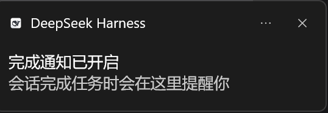
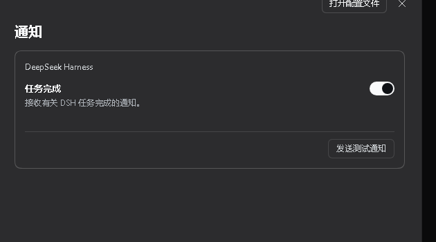

# dsh-turn-notify

[](https://github.com/XEsx630/dsh-turn-notify/actions/workflows/test.yml)
[](LICENSE)

DeepSeek Harness 每轮任务结束时，弹出一条真正的 Windows 系统通知（Toast + 提示音）。



## 功能

- **任务结束才通知**：同时参考 Session 的 `running` 位、会话列表和 `uiSession.sessionStatus`；三者都变为非运行态时触发。不是每条消息、每次工具调用，也不是插件启动时。
- **真正的系统 Toast**：由 Host 进程通过 PowerShell WinRT 发出，进入 Windows 通知中心；不依赖浏览器 Notification 权限，也不受 DSH 每次启动随机回环端口的影响。
- **窗口不在前台也能看到**：DSH 最小化或被其他应用盖住时，Toast 仍显示在最上层。
- **每轮都通知**：包括当前正在查看的会话；跳过子代理会话和空白会话。
- **提示音**：Toast 播放 Windows 系统通知音；仅当 Host 路由不可用时才回退到应用内 WebAudio 两声短音。
- **设置页**：设置 → 通知，可开关，也可发送一条测试通知。



## 安装

需要 **Windows 上的 DeepSeek Harness Desktop**（在 `0.2.1-rc.2` 上开发并测试）。

从 GitHub 直接安装：

```powershell
dsh plugin --profile desktop add github:XEsx630/dsh-turn-notify
```

或克隆后从本地目录安装：

```powershell
git clone https://github.com/XEsx630/dsh-turn-notify.git
dsh plugin --profile desktop add .\dsh-turn-notify
```

安装后如果设置里暂时没有“通知”，重启一次 DSH。

## 使用

1. 打开 **设置 → 通知**，确认“任务完成”开关为开启状态。
2. 点“发送测试通知”，应看到 Windows 系统 Toast（即使 DSH 不在前台）。
3. 之后每轮任务完成时都会收到通知：标题为会话名，正文为“任务已完成 · 点击返回会话”。

## 实现

插件分两半：

- **Client**（`client.js`）：跟踪 Session 的 `running` 位，并用 `uiSession.sessionStatus` 和会话列表兜底；完成时调用 Host 的 `/dsh-turn-notify/notify`。
- **Host**（`index.js`）：在本机回环路由上接收请求，用 PowerShell 的 WinRT 投影发送带系统通知音的 Windows Toast。

这样做的原因：渲染进程的 `Notification` 权限绑定在 DSH 的随机回环端口上，每次重启都会丢失；Host 直接发 Toast 则不受影响。

## 开发

无需安装依赖，测试使用 Node 内置模块：

```powershell
node test/simulate.cjs
```

## 已知限制

- 仅支持 Windows；Toast 依赖 `electron.app.DeepSeek Harness` 这个 AppUserModelID，DSH 桌面端更新后如改动 AUMID，需要同步修改 `index.js`。
- DSH 窗口可以最小化或处于其他应用后面，但需要保持运行；完全退出 DSH 后无法检测任务完成，也就不会通知。
- Toast 声音跟随 Windows 通知声音设置；如果系统关闭了通知音，Toast 会静音。

## License

[MIT](LICENSE)
